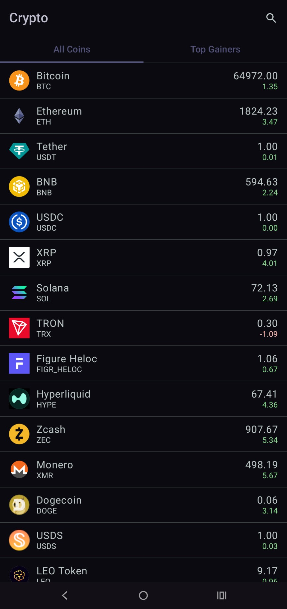

# JetpackCrypto

A real-time cryptocurrency price tracker built as a **step-by-step teaching project** for Android Jetpack. The app fetches the top coins from the [CoinGecko API](https://www.coingecko.com/en/api) and displays them in a live, paginated list with a detail screen for each coin.

Each class maps to a branch. Checkout any branch to see the app at that exact stage of the course.

---

## What the App Does

<table>
<tr>
<td>

- Fetches the top 100 cryptocurrencies from CoinGecko (no API key required)
- Displays a paginated list with coin name, symbol, logo, and current USD price
- Tapping a coin opens a detail screen with 24h high/low and price change
- Background price refresh via WorkManager every 15 minutes
- Two tabs: **All Coins** and **Top Gainers** (ViewPager2 → Compose HorizontalPager)
- Search with debounced query, presented as a ModalBottomSheet
- Snackbar error handling with custom error content
- Custom theme via [KouraiKhryseai](https://github.com/josemg08/KouraiKhryseai)

</td>
<td width="40%">



</td>
</tr>
</table>

---

## Course Structure

| Branch       | Topics                                                                                          |
|--------------|-------------------------------------------------------------------------------------------------|
| `Main`       | Final project — all features, Hilt DI, comprehensive tests                                       |
| `Class1`     | MVVM Architecture, ViewModel, LiveData, Retrofit, Repository Pattern                             |
| `Class2`     | Room Database, Entities, DAOs, Paging 3, RemoteMediator                                          |
| `Class3`     | View Binding, Data Binding, Parcelable                                                           |
| `Class4`     | WorkManager, ViewPager2, TabLayout, Hilt DI, Assisted Injection, Testing (Fakes, JUnit)          |
| `Class5`     | Jetpack Compose migration, Compose Navigation, state hoisting, recomposition, Material 3         |
| `Class5.1`   | Recomposition optimizations (`remember`, `derivedStateOf`), previews, smaller composables        |
| `Class6`     | Kotlin Flows replacing LiveData, `StateFlow`, `SharedFlow`, sealed `UiState`, Scaffold, Semantics|
| `Class6.1`   | Search feature, Flow operators (`flatMapLatest`, `combine`, `debounce`)                          |
| `Class6.2`   | Search as Compose `ModalBottomSheet`, `SearchEffect` via `SharedFlow`                            |
| `Class6.3`   | KouraiKhryseai theme library (`KTheme`), `ConstraintLayout`, centralized color tokens            |
| `Class6.4`   | `SnackbarHost`, error `UiState`, `EmptyErrorContent` component                                   |

Each branch builds on the previous one. The domain layer and repository interface are established in Class 1 and remain stable throughout — only the UI and DI layers evolve. The Contract pattern (interfaces between View and ViewModel) is what makes every class-to-class migration surgical.

---

## Concepts Covered

**Class 1 — MVVM Foundation**
- **MVVM Architecture** — strict separation between Model, ViewModel, and View. Every layer communicates through interfaces, never concrete classes.
- **ViewModel** — survives configuration changes (rotation). Holds all UI state and business logic out of the Activity.
- **LiveData** — observable state holder. The Activity reacts to data changes without polling or callbacks.
- **Lifecycle-aware** — LiveData only delivers updates when the UI is active and automatically cleans up observers on destroy.

**Class 2 — Local Persistence & Paging**
- **Room** — SQLite abstraction. Define the schema as Kotlin data classes (`@Entity`), query through type-safe interfaces (`@Dao`).
- **Entities & DAOs** — `CoinEntity` maps to a database table; `CryptoDao` defines queries as suspend functions and `PagingSource` returns.
- **Paging 3 + RemoteMediator** — loads pages from the network, stores them in Room, and serves the UI from the local database. Room becomes the single source of truth.

**Class 3 — Binding**
- **View Binding** — eliminates `findViewById`. Every layout generates a typed binding class. No more `NullPointerException` from wrong IDs.
- **Data Binding** — the layout reads directly from the domain model (`@{coin.name}`). The Activity just sets `binding.coin = it`.
- **Parcelable** — pass rich domain objects across Activity boundaries. `@Parcelize` generates the implementation at compile time.

**Class 4 — Background Work, DI & Testing**
- **WorkManager** — schedules guaranteed background work. Constraints (network required), periodic intervals, and automatic retry are built in.
- **ViewPager2** — swipeable tabs backed by `FragmentStateAdapter`. Introduces Fragments as lightweight tab hosts inside an Activity.
- **Hilt** — replaces manual `ViewModelProvider.Factory` classes. `@AndroidEntryPoint`, `@HiltAndroidApp`, DI modules.
- **Assisted Injection** — ViewModels receive stable deps from Hilt (`CryptoRepository`) and runtime deps from the UI (`CryptoNavigation`) via `@AssistedFactory`.
- **Testing** — fakes (`FakeCryptoRepository`, `FakeCryptoNavigation`) instead of Mockito. Fast, readable, behave like real implementations.

**Class 5 — Jetpack Compose Migration**
- **Compose** — declarative UI replaces XML layouts. `setContentView` → `setContent`. The ViewModel is untouched — Compose consumes the same LiveData contracts via `observeAsState()`.
- **Compose Navigation** — single Activity, declarative NavGraph, type-safe routes.
- **State Hoisting & UDF** — state flows down (params), events flow up (lambdas). Composables become stateless and reusable.
- **Recomposition** — `remember`, `derivedStateOf`, `@Immutable`, `@Stable` to prevent unnecessary recompositions.
- **Material 3** — themes defined in Kotlin. Goodbye `styles.xml` and `colors.xml`.

**Class 5.1 — Compose Optimizations**
- Separated large composables into smaller ones (`CryptoListTabsScreen`, `CoinItem`, `CoinListPage`, `TopGainersPage`).
- Added `@Preview` functions for every composable.
- Applied `remember` and `derivedStateOf` for recomposition performance.

**Class 6 — Reactive State (Flows)**
- **Kotlin Flows** replace LiveData — coroutine-native, rich operators, KMP-ready.
- **`StateFlow`** — replaces `LiveData` in contracts. `collectAsStateWithLifecycle()` for lifecycle-safe collection.
- **`SharedFlow`** — one-time events (navigation, snackbar) that must not replay on rotation.
- **Sealed `UiState`** — `Loading`, `Success`, `Error` modeled exhaustively. `when` expressions are compiler-checked.
- **Scaffold & TopBar** — Material 3 layout structure.
- **Semantics** — accessibility (`mergeDescendants`, `contentDescription`) and testability.

**Class 6.1 — Search**
- **`SearchViewModel`** with Flow operators: `flatMapLatest`, `combine`, `debounce`.
- `SearchUiState` with query and filtered coins.

**Class 6.2 — Bottom Sheet Search**
- `ModalBottomSheet` replaces fragment-based search.
- `SearchEffect` via `SharedFlow` for one-time navigation events.

**Class 6.3 — Theming**
- [KouraiKhryseai](https://github.com/josemg08/KouraiKhryseai) theme library — `KTheme`, `KTokens`, `extendedColors`.
- `ConstraintLayout` in Compose for complex layouts.
- Centralized dimensions and colors.

**Class 6.4 — Error Handling**
- `SnackbarHost` for transient error messages.
- `EmptyErrorContent` composable for empty/error states.
- Error states modeled in sealed `UiState`.

---

## Architecture

```
domain/          Pure Kotlin. Models + Repository interface. No Android imports.
data/            Retrofit, Room, mappers, repository implementation.
di/              Hilt modules (DatabaseModule, NetworkModule, RepositoryModule).
viewmodels/      ViewModels with @AssistedInject. Contracts define the UI boundary.
ui/              Compose screens, navigation, contracts (UiState, Effect, Contract).
```

The ViewModel always talks to a `CryptoRepository` interface. The UI always talks to a Contract interface (`CryptoListContract`, `SearchContract`, etc.). Hilt wires concrete classes via DI modules. This is what makes every class-to-class migration surgical — the Class 5 → Class 6 diff swapped `LiveData` for `StateFlow` in the contracts, and the ViewModel business logic was zero changes.

---

## Tech Stack

| Library               | Version    |
|-----------------------|------------|
| Kotlin                | 2.1.0      |
| Android Gradle Plugin | 9.4.0      |
| Hilt                  | 2.60.1     |
| KSP                   | 2.1.0-1.0.29 |
| Retrofit + OkHttp     | 3.x / 5.x  |
| Coil                  | 2.7.0      |
| Room                  | 2.8.4      |
| Paging 3              | 3.5.1      |
| WorkManager           | 2.11.2     |
| Jetpack Compose BOM   | 2025.07.00 |
| Navigation Compose    | 2.9.8      |
| KouraiKhryseai        | 1.0.3      |
| ConstraintLayout      | 2.2.2      |

API: [CoinGecko Public API](https://www.coingecko.com/en/api) — free tier, no key required.
